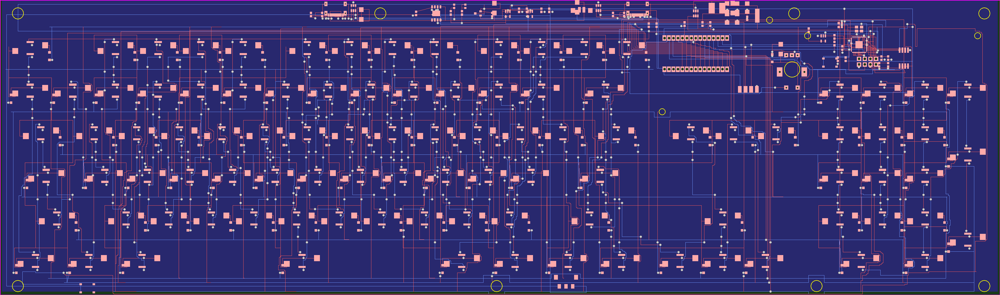
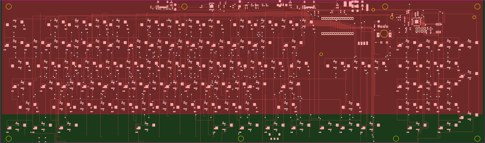
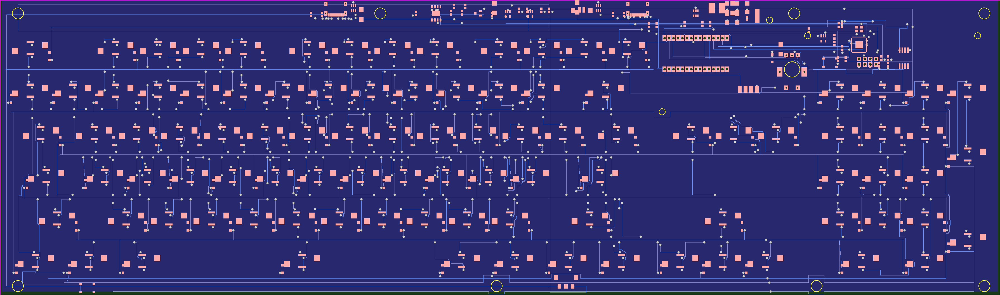

# K98 — 98 键蓝牙三模机械键盘

98 键 (含数字小键盘 + 音量旋钮) 客制化键盘:RP2040 主控 + nRF52840 无线模块双核协控,
98 颗 SK6812MINI-E 每键 RGB (绫波丽蓝常亮 + 按键水波纹灯效),双 USB-C 口 + TP4056 锂电充电,
内置升压电路驱动 RGB 灯链,外接 1.9" TFT 屏 (SPI)。







## 工作原理

```
┌──────────────┐  SPI    ┌──────────┐
│  RP2040 主控  ├────────>│ TFT 屏幕 │ (内置图片/状态页)
│ (矩阵/USB/RGB)│         └──────────┘
│  └ QSPI─W25Q16 │
├──────────────┤
│ UART_TX       │──> nRF52840 模块 (蓝牙 5.0 三模)
├──────────────┤
│ GPIO14 ──74AHCT1G125──> SK6812 ×98 菊花链 (5V 电平转换)
├──────────────┤
│ USB-C ×2 ──USBLC6 ESD──> DP/DM ─> RP2040 / nRF52840
├──────────────┤
│ 电源: 锂电(PH2.0) → 开关 → Q1(AO3401) → TP4056 充电
│       │                    └→ MT3608 升压 5V → LED5V_F (灯链)
│       └→ RT9013 (3.3V) + ME6211 (1.1V 核心供电)
└──────────────┘
```

- **键盘矩阵**: 11 列 × 9 行,98 个热插拔轴座 (凯华 CPG1511) + 1N4148W 二极管,
  编码器按压占矩阵一个键位;EC11 旋钮独立 A/B 相 + 按压保护二极管 D3。
- **RGB**: 单线菊花链 (RGB_IN → L0..L97 → RGB_OUT97),470Ω 串阻 + 缓冲器,
  MT3608 升压到 ~5V 经 1.5A PTC 保险丝供电,每键 22µF 储能。
- **固件**: 屏幕状态页 + 按键水波纹 (波速 125mm/s,定点查表),三模切换,
  详见 `Firmware/K98_CoPro.ino` (Arduino 框架, RP2040 内核)。

## 文件结构

| 文件 | 说明 |
|---|---|
| `K98键盘.eprj2` | EasyEDA Pro 离线工程 (原理图 8 页 + PCB 布局布线) |
| `Gerber/` | Gerber RS-274X (K98.GTL 顶层 / K98.GBL 底层 / K98.GKO 板框) + Excellon 钻孔 (K98-PTH.TXT) |
| `bom.csv` | BOM (按位号合并, 含立创商城 C 编号) |
| `pick-and-place.csv` | 贴片坐标 (嘉立创 SMT 格式) |
| `Firmware/K98_CoPro.ino` | 协控固件源码 (屏幕 + RGB 灯效) |
| `BOM_物料清单.md` | 详细物料表 (分类说明 + 采购指引) |
| `下单步骤.md` | 嘉立创 PCB 打样 / SMT 贴片下单指引 |

## 如何复刻

1. **打板**: 把 `Gerber/` 或 `K98键盘.eprj2` 上传嘉立创下单 (2 层, 447×132mm, 1.6mm);
2. **贴片**: 上传 `bom.csv` + `pick-and-place.csv` (顶层贴片), 主要 IC:
   RP2040=C2040, W25Q16=C131025, TP4056=C382139, MT3608=C83572,
   SK6812MINI-E=C5149201, USB-C=C165948;
3. **手焊**: 轴座×98、EC11、拨动开关、JST 座、nRF52840 模块 (自购);
4. **烧录**: SWD 四焊盘 (板右上 H1) 接 DAP-Link, 烧 `Firmware/K98_CoPro.ino`;
5. **装配**: 装轴 → 键帽 → 锂电池 (3.7V, PH2.0 插头) → 外壳。

## 电源规格

| 轨道 | 来源 | 用途 |
|---|---|---|
| VBUS | USB-C 双口理想二极管合流 | 充电输入 |
| VSYS | 电池/USB 经 Q1 切换 | 系统电源 |
| 3V3 | RT9013-33 (500mA) | RP2040 IO / nRF 模块 / 屏幕 |
| 1V1 | ME6211C11 | RP2040 内核 |
| LED5V | MT3608 升压 ~5V (1.5A PTC) | 98×SK6812 灯链 |

全部 RGB 满白约 58W 不可行, 固件限幅 50% (~1.4A), 常亮模式 25% (约 0.7A)。
